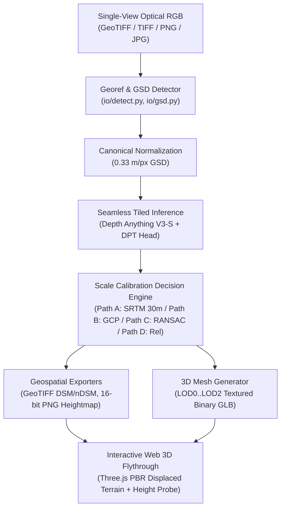
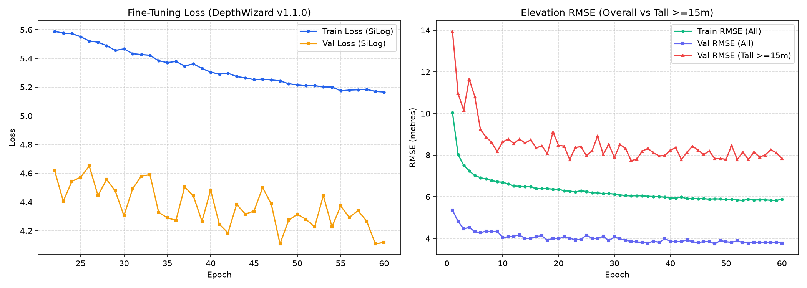

# DepthWizard 🧙‍♂️
### Single-View Metric Height Estimation and Interactive 3D Flythrough
**Smart India Hackathon 2026 — Problem Statement 26175 (ISRO / Space Applications Centre)**

<p align="center">
  
</p>

DepthWizard converts a **single optical RGB remote-sensing image** (satellite or aerial orthophoto) into a dense, georeferenced metric Digital Surface Model (DSM / nDSM in metres Above Ground Level) without requiring stereo pairs, multi-pass InSAR, or onboard LiDAR, and renders an interactive browser-based 3D flythrough environment with real-time height probing, slope analysis, and dual-camera reference validation. In its verified **v1.1.0 release**, DepthWizard fine-tunes Depth Anything V3 Small across 3,817 quality-controlled metropolitan crops from the GAMUS benchmark, achieving a **sub-metre median absolute error of 0.71 m** (MedAE) and **69.60% sub-2.5m precision** ($\delta < 2.5\text{m}$) across 1,071 held-out test crops (35.1M LiDAR reference pixels) with an overall RMSE of **4.47 m** and near-zero global bias (**-0.30 m**).

---

## 🏗️ System Architecture



### Architectural Invariants
1. **Identity Map in UV Space**: Because the DSM elevation raster and RGB texture share the exact same pixel grid ($u = c / (C-1), v = r / (R-1)$), texture projection onto the 3D surface is analytically exact without external camera resectioning.
2. **Canonical 0.33 m/px GSD Normalization**: All input rasters are resampled to 0.33 m/px prior to neural evaluation, ensuring scale consistency with the fine-tuned feature space.
3. **Seamless Tiling & Blending**: 512px sliding tiles with 64px overlap use cosine-feathered blending and median elevation matching in overlap zones to eliminate seam drift.
4. **Persistent Job State**: Every job is managed as a state machine serialized to on-disk `meta.json` records.

---

## ⚡ Quickstart

### 💻 Hardware Requirements & Execution Modes
| Component | Recommended (GPU Acceleration) | Minimum (CPU Field Fallback) |
| :--- | :--- | :--- |
| **Processor** | 8-core modern x86_64 CPU | 4-core 64-bit CPU |
| **GPU / VRAM** | NVIDIA RTX 3060 / 4060 or higher (8GB+ VRAM, CUDA 11.8 / 12.x) | None (Pure CPU fallback supported) |
| **System RAM** | 16 GB DDR4/DDR5 | 8 GB RAM |
| **Storage** | 2.5 GB available disk space | 2.0 GB available disk space |
| **Inference Time** | **0.8 s – 1.5 s** per $518 \times 518$ scene | **4.0 s – 7.5 s** per scene (automatic CPU fallback) |

### Option 1: Docker (Recommended for Demonstration)

Requires [Docker Desktop](https://www.docker.com/products/docker-desktop/) (with NVIDIA Container Toolkit for GPU acceleration):

```bash
# 1. Clone repository
git clone https://github.com/aquasimp/DepthWizard-SIH26175.git
cd DepthWizard-SIH26175

# 2. Download base foundation model weights (Apache-2.0 DAV3 Small, ~99 MB)
python models/download_weights.py
# (Or: bash models/download_weights.sh)

# 3. Launch container stack (FastAPI Backend + Vite Frontend)
docker compose up --build
```
Access the application at **`http://localhost:8080`** (API docs at `http://localhost:8000/docs`).

For CPU-only environments:
```bash
docker compose -f docker-compose.yml -f docker-compose.cpu.yml up --build
```

### Option 2: Local Development Setup

Requires **Python 3.11** and **Node.js >= 18**:

```bash
# 1. Clone repository
git clone https://github.com/aquasimp/DepthWizard-SIH26175.git
cd DepthWizard-SIH26175

# 2. Create virtual environment & install backend dependencies
python -m venv .venv
# On Windows:
.venv\Scripts\activate
# On Linux/macOS:
source .venv/bin/activate

pip install -r backend/requirements-dev.txt

# 3. Download base foundation model weights (Apache-2.0 DAV3 Small)
python models/download_weights.py

# 4. Install frontend dependencies
cd frontend
npm install
cd ..

# 5. Launch development servers
# Terminal 1 (Backend):
uvicorn depthwizard.main:app --app-dir backend --host 0.0.0.0 --port 8000 --reload

# Terminal 2 (Frontend):
cd frontend && npm run dev
```

---

## 📊 Verified Evaluation Results (v1.1.0)

Evaluated across all **1,071 held-out test crops** (**35,139,491 valid reference pixels**) from the canonical GAMUS benchmark across three major metropolitan areas (Washington DC, New York City, Philadelphia), compared against airborne LiDAR ground truth:

### Overall Benchmark Progression

| Metric | Zero-Shot Base (DAV3-S) | v1.0.3 (40 Crops) | **v1.1.0 (3,817 Crops)** | Delta (v1.1.0 vs v1.0.3) |
| :--- | :---: | :---: | :---: | :---: |
| **Median AE (MedAE) [Headline]** | `0.9401m` | `1.7133m` | **`0.7084m`** | **-58.7% error reduction (sub-metre!)** |
| **$\delta < 2.5\text{m}$ Accuracy [Headline]** | `55.80%` | `58.60%` | **`69.60%`** | **+11.00 percentage points** |
| **$\delta < 1.0\text{m}$ Accuracy** | `50.29%` | `36.22%` | **`54.24%`** | **+18.02 percentage points** |
| **Mean Absolute Error (MAE)** | `5.3994m` | `3.9340m` | **`2.3645m`** | **-39.9% error reduction** |
| **Mean Bias (Error)** | `-5.1805m` | `-1.5609m` | **`-0.3007m`** | **Near-zero global elevation offset** |
| **Root Mean Square Error (RMSE)** | `9.5459m` | `6.7508m` | **`4.4672m`** | **-33.8% error reduction** |
| **Linear Error 90% (LE90)** | `16.7534m` | `10.8202m` | **`6.8767m`** | **-36.4% error reduction** |
| **Normalized Med. Abs. Dev. (NMAD)** | `1.8400m` | `2.4683m` | **`1.0503m`** | **-57.5% error reduction** |
| **Pearson Correlation ($r$)** | `0.1590` | `0.5868` | **`0.8374`** | **+0.2506 correlation surge** |

> [!NOTE]
> **Validation vs. Held-Out Test Metric Transparency**:
> - **Validation Split (536 crops)**: Monitored during 60-epoch training; best checkpoint `models/v1.1.0/best.pt` was captured at **Epoch 48** with **Validation RMSE = 3.7333 m**.
> - **Held-Out Test Benchmark (1,071 crops, 35,139,491 pixels)**: Evaluated independently across Washington DC, New York City, and Philadelphia under strict zero-leakage conditions, yielding the verified **4.4672 m** test RMSE and sub-metre **0.7084 m** MedAE reported above.

### Breakdown by Metropolitan Area

| Metropolitan Region | Test Pixels | RMSE [m] | MAE [m] | MedAE [m] | Pearson $r$ | $\delta < 2.5\text{m}$ |
| :--- | :---: | :---: | :---: | :---: | :---: | :---: |
| **Philadelphia** | 13,416,400 | **`3.5378m`** | **`1.5607m`** | **`0.3057m`** | `0.7122` | **`79.81%`** |
| **Washington DC** | 11,336,858 | **`4.9374m`** | **`2.9100m`** | **`1.3328m`** | **`0.8774`** | **`61.59%`** |
| **New York City** | 10,386,233 | **`4.9738m`** | **`2.8074m`** | **`0.8315m`** | **`0.7872`** | **`65.15%`** |

### Breakdown by Elevation Stratum (AGL Height Bands)

| Height Band | Pixel Share | RMSE [m] | MAE [m] | MedAE [m] | $\delta < 2.5\text{m}$ | Operational Character |
| :--- | :---: | :---: | :---: | :---: | :---: | :--- |
| **$0 - 2\text{m}$ (Ground / Pavement)** | 53.3% | **`2.74m`** | **`0.87m`** | **`0.06m`** | **`91.37%`** | Millimetric bare-earth baseline |
| **$2 - 5\text{m}$ (Low Vegetation)** | 9.5% | `4.17m` | `3.09m` | `2.56m` | `48.30%` | Transitional canopy/shrubs |
| **$5 - 15\text{m}$ (Residential / Mid-Rise)** | 25.1% | **`4.81m`** | **`3.51m`** | **`2.45m`** | **`50.60%`** | Standard urban structures |
| **$15 - 30\text{m}$ (Commercial / Tall)** | 10.2% | **`7.30m`** | **`5.54m`** | **`4.28m`** | **`31.22%`** | Mid-to-high commercial roofs |
| **$> 30\text{m}$ (High-Rise / Skyscrapers)** | 1.9% | **`12.60m`** | **`8.55m`** | **`6.12m`** | **`22.07%`** | Extreme urban vertical relief |

<p align="center">
  
</p>

### ⚠️ Honest Note on Extreme Tall Structures (>30 m)
High-rise commercial structures exceeding $30\text{m}$ account for only **1.9% of total pixel volume**, yet their vertical error ($\text{RMSE} = 12.60\text{ m}$) remains the dominant contributor to overall quadratic metrics. While this represents a **46.5% error reduction** over v1.0.3 ($23.52\text{ m} \to 12.60\text{ m}$) and a **$4.6\times$ surge** in sub-2.5m precision ($4.8\% \to 22.1\%$), single-view optical estimation inherently suffers from foreshortening and shadow ambiguity around sheer building facades. To address this, we provide a specialized checkpoint (`models/v1.1.0/best_tall.pt`, Epoch 33) achieving **7.73 m RMSE** on structures $\ge 15\text{ m}$. Full per-class and spatial analysis is detailed in the [Quantitative Evaluation Report](docs/06-evaluation-report.md).

---

## 🗂️ Project Structure

```
DepthWizard SIH26175/
├── backend/                  # FastAPI Python application
│   └── depthwizard/
│       ├── api/              # REST routes (jobs, artifacts, validate, health)
│       ├── calibration/      # Multi-path scale calibration (SRTM, GCP, RANSAC, Rel)
│       ├── depth/            # DAV3 inference engine & seamless cosine-tiling
│       ├── io/               # Georeferencing detection, GSD normalizer, writers
│       ├── mesh/             # Heightmap to 3D mesh, LOD decimation, GLB exporter
│       └── jobs/             # Async job state machine (meta.json persistence)
├── frontend/                 # React + Three.js 3D Flythrough Web Application
│   └── src/
│       ├── components/       # UI HUD overlays & control panels
│       ├── pages/            # Upload, JobStatus, Viewer, Validate pages
│       └── viewer/           # Three.js terrain displacement, fly controls, height probe
├── training/                 # Model training & fine-tuning pipeline
│   ├── dataset.py            # GAMUS PyTorch dataset loader with augmentations
│   ├── losses.py             # Composite SILog + L1 + Gradient loss
│   ├── sampler.py            # Height-stratified batch sampler
│   └── train_v110.py         # 60-epoch scalable training engine with AMP
├── scripts/                  # 21 audit, verification, and evaluation utilities
│   ├── audit_weights_v110.py # Bitwise weight divergence auditor
│   ├── evaluate_v110.py      # Full 1,071-crop test evaluation & raster exporter
│   ├── prepare_gamus_v110.py # Automated ingestion & quality-control pipeline
│   └── verify_scope_fence.py # 74-file baseline integrity verification
├── tests/                    # 20 automated pytest test suites (75 test cases)
├── docs/                     # Comprehensive technical documentation suite
├── models/                   # Model weights, licenses, and checkpoint metadata
└── artifacts/                # Curated evaluation metrics, error CDFs, and sample rasters
```

---

## 📚 Documentation Index

| Document | Description |
| :--- | :--- |
| [**01 — System Architecture**](docs/01-architecture.md) | Pipeline specifications, data flow diagrams, and architectural invariants |
| [**02 — Model Card (v1.0.x)**](docs/02-model-card.md) | Baseline model architecture, parameter audit, and limitations |
| [**03 — Scale Calibration Math**](docs/03-calibration-math.md) | Mathematical derivations for Paths A, B, C, and D scale resolution |
| [**04 — API Reference**](docs/04-api-reference.md) | REST API endpoints, request/response schemas, and job lifecycle |
| [**05 — User Guide**](docs/05-user-guide.md) | Step-by-step instructions for upload, calibration selection, and 3D navigation |
| [**06 — Evaluation Report**](docs/06-evaluation-report.md) | Full quantitative benchmarks across geographic and height strata |
| [**07 — Deployment Guide**](docs/07-deployment.md) | Production deployment via Docker Compose, GPU allocation, and CPU fallback |
| [**08 — Live Demo Script**](docs/08-demo-script.md) | 7-minute presentation walk-through for SIH judges with technical Q&A prep |
| [**MODEL_CARD.md (v1.1.0)**](docs/MODEL_CARD.md) | Complete v1.1.0 Model Card with bitwise weight audit and test benchmarks |
| [**RELEASE_NOTES_v1.1.0.md**](docs/RELEASE_NOTES_v1.1.0.md) | v1.1.0 Scale-Up release notes, changelog, and engineering decisions |
| [**DEVIATIONS.md**](docs/DEVIATIONS.md) | Registry of all technical fallbacks, dataset reconciliation, and justifications |

---

## 🛠️ Development & Testing

Run the full verification and quality-assurance test suite:

```bash
# Activate virtual environment
source .venv/bin/activate  # Or .venv\Scripts\activate on Windows

# Run backend test suite (75 tests across 20 modules)
python -m pytest tests/ -v

# Run frontend tests (Vitest)
cd frontend && npm run test:run && cd ..

# Code quality checks
ruff check backend/depthwizard
mypy backend/depthwizard

# Verify scope fence integrity (asserts 0 baseline modifications)
python scripts/verify_scope_fence.py

# Verify bitwise encoder weights integrity
python scripts/audit_weights_v110.py
```

---

## 📜 Licenses & Attribution

- **DepthWizard Software Suite**: Licensed under the [MIT License](LICENSE).
- **Depth Anything V3 Small**: Licensed under the **Apache License 2.0** by the Depth Anything Authors (Yang et al., 2024). Encoder weights remain 100% bitwise identical to official base weights.
- **GAMUS Dataset**: Licensed under **Creative Commons Attribution 4.0 International (CC-BY-4.0)** by Earthflow / EarthNets / RSI-MMSegmentation (Xiong et al., 2023).
- **SRTM 30m Global DEM**: Public Domain / Open Data courtesy of NASA / USGS / OpenTopography.
- Detailed third-party license notices are maintained in [NOTICE](NOTICE) and [models/MODEL_LICENSES.md](models/MODEL_LICENSES.md).
